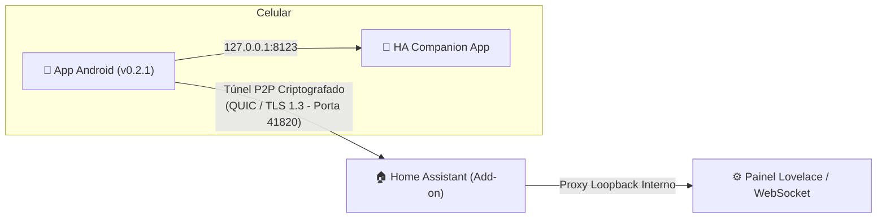

# 🌐 HA P2P Tunnel - Documentação Oficial

<p align="center">
  
</p>

<p align="center">
  <b>Acesso remoto descentralizado, ultrarrápido e criptografado de ponta a ponta ao seu Home Assistant</b><br>
  <i>Sem IP público • Sem abrir portas no roteador • Sem DuckDNS • Imune a CGNAT</i>
</p>

---

## 📖 Visão Geral

O **HA P2P Tunnel** conecta seu smartphone Android diretamente ao seu servidor Home Assistant utilizando a moderna pilha de protocolos descentralizados **libp2p** (a mesma tecnologia que move o ecossistema IPFS e Ethereum).

Ao contrário de serviços convencionais baseados em servidores intermediários ou túneis centralizados:
* **Zero Servidores Centralizados:** O túnel estabelece uma ligação P2P direta via **QUIC (UDP)** e **TCP** com perfuração de NAT (Hole Punching).
* **Compatível com IPv6 e CGNAT:** Conecta mesmo se o seu provedor de internet (Vivo, Claro, Starlink, operadoras de bairro) colocar você atrás de CGNAT estrito.
* **Criptografia Militar:** Todas as comunicações são seladas com TLS 1.3 e handshake Noise autenticado por chaves Ed25519.
* **Zero Interferência na Internet do Celular:** Não cria VPN de sistema. Seus aplicativos de banco, WhatsApp e redes sociais navegam normalmente pela sua conexão móvel sem bloqueios.



---

## 🚀 Como Usar: Passo a Passo Inicial

### 1. Iniciar o Add-on no Home Assistant
1. Clique em **Iniciar** no card deste Add-on.
2. Certifique-se de marcar a opção **Iniciar na inicialização** e **Monitoramento**.
3. Clique em **Abrir Interface Web** (ou acerte pelo menu lateral esquerdo **HA P2P Tunnel**).

### 2. Baixar o Aplicativo no Celular
1. No painel que abrir no seu computador, veja o **Passo 1 (Baixar App Android)**.
2. Aponte a câmera do seu celular para o QR Code da esquerda ou acerte o link direto na sua rede local para baixar o arquivo `HA_P2P_Tunnel.apk`.
3. Instale o APK no seu aparelho Android.
   > [!IMPORTANT]
   > Se você já tinha uma versão anterior instalada, **desinstale o app antigo antes de instalar o novo** para evitar conflito de assinaturas com a chave de produção oficial.

### 3. Conectar com 1 Toque
1. Abra o aplicativo **HA P2P Tunnel** no seu celular (verifique o selo **`v0.2.1`** no topo).
2. Toque no botão **📷 Escanear QR Code do HA**.
3. Aponte a câmera para o QR Code do **Passo 2** na tela do computador.
   * O aplicativo lerá instantaneamente o **Peer ID**, a chave **PSK** (se configurada) e os **endereços diretos IPv6/LAN** do seu servidor!
4. Toque no botão verde **CONECTAR**.
5. O status mudará imediatamente para **Conectado**!

### 4. Abrir o Home Assistant
* Se você tem o app oficial **Home Assistant Companion** instalado, o botão da notificação e o botão principal do app abrirão o Home Assistant oficial diretamente!
* Caso prefira o navegador, ele abrirá o painel em `http://127.0.0.1:8123`.

---

## 🔒 Modo de Rede Privada (Chave PSK - Opcional)

Por padrão, a conexão exige que você conheça o `PeerID` do servidor. Se você quiser uma camada extra de segurança contra acessos indesejados:

1. Na aba **Configuração** deste Add-on:
   ```yaml
   secret_psk: "MinhaSenhaSuperSecreta123"
   ```
2. Clique em **Salvar** e reinicie o Add-on.
3. No aplicativo Android, o QR Code gerado pelo painel já incluirá a sua chave automaticamente! Nenhum cliente conseguirá abrir streams sem a chave correspondente.

---

## 📊 Métricas e Painel Ingress

O painel deste Add-on oferece monitoramento em tempo real:
* **Dispositivos Conectados:** Agrupados por celular, exibindo o status online, tipo de transporte (ex: IPv6 QUIC), canais paralelos ativos e volume de dados trafegados.
* **Diagnóstico Remoto:** Quando o celular conecta, ele transmite um mini-relatório com o tempo exato de busca e logs.
* **Ações de Cópia com 1 Clique:**
  * 📋 **Copiar Logs (Técnico):** Copia os registros brutos do túnel para depuração.
  * 📄 **Copiar Resumo (Humano):** Copia um sumário limpo com os dados de conexão.
  * 📥 **Baixar CSV:** Exporta o histórico recente de conexões.

---

## ❓ Perguntas Frequentes (FAQ)

### O app gasta muita bateria no celular?
Não. O motor de rede entra em repouso profundo logo após a negociação inicial. O WakeLock de CPU é liberado após os primeiros 30 segundos, permitindo que o Android entre em modo Doze enquanto mantém os sockets QUIC ativos.

### O app interfere com bancos ou WhatsApp?
Zero interferência. O aplicativo não utiliza a interface de VPN do sistema (`VpnService`), portanto não altera a rota padrão de internet do telefone. Apenas as chamadas para `127.0.0.1:8123` são encaminhadas para o Home Assistant.

### Por que o Android Play Protect exibe aviso ao instalar?
Como o aplicativo é distribuído como código aberto diretamente pelo GitHub (sem passar pela loja comercial da Google Play Store), o Play Protect pode emitir um aviso genérico de "App desconhecido". O aplicativo é 100% assinado pelo desenvolvedor com a chave oficial de produção. Você pode clicar em "Instalar assim mesmo".

---

## 👨‍💻 Desenvolvedor e Créditos

* **Autor:** Jhonatan Garcia ([@jhona1234](https://github.com/jhona1234-del))
* **Repositório:** [github.com/jhona1234-del/HA-P2P-Tunnel](https://github.com/jhona1234-del/HA-P2P-Tunnel)
* **Licença:** MIT License (Código aberto e livre para a comunidade)
